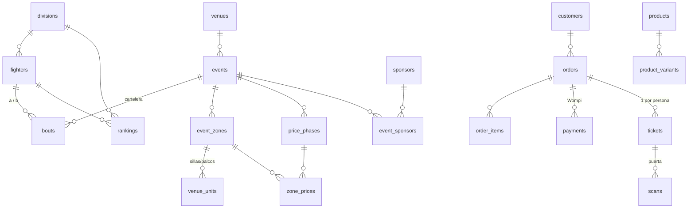

# Base de datos · One True (borrador v0.2 · 2026-10-19)

SQL: [`supabase/migrations/0001_esquema_inicial.sql`](../supabase/migrations/0001_esquema_inicial.sql) — validado en Postgres (PGlite), aún no aplicado en ningún servidor.

## Principio
Hoy todo el contenido está en `src/data/*.ts` (ficticio) y el panel/checkout usan datos simulados en el navegador.
El esquema reemplaza eso 1 a 1, en el esquema `onetrue` de Supabase (`supabase.cynocta.com`, donde ya vive `taquilla`).

**La base guarda datos y referencias; los archivos van a Storage.** Del Drive solo se sube la versión web optimizada
(WebP/AVIF, ~1600 px máx.) y la tabla `media` guarda la ruta + el `drive_file_id` del original.

## Módulos

| Módulo | Tablas | Reemplaza |
|---|---|---|
| Medios | `media` | `photos.ts`, `public/` |
| Deportivo | `divisions`, `fighters`, `venues`, `events`, `bouts`, `rankings`, `news`, `news_fighters` | `fighters.ts`, `events.ts`, `news.ts`, `divisions.ts`, `P4P` |
| Patrocinio | `sponsors`, `event_sponsors` | estado del panel (Sponsors) |
| Inventario | `event_zones`, `venue_units`, `price_phases`, `zone_prices` | `TICKETS`, `PRICE_PHASES`, `venue.ts` |
| Tienda | `products`, `product_variants`, `product_media`, `event_products`, `shop_orders`, `shop_order_items` | `ADDONS` del checkout; tienda de merch (fase 1 por WhatsApp) |
| Contenido | `brands`, `pages`, `faqs` | textos legales y preguntas frecuentes |
| Ventas | `customers`, `orders`, `order_items`, `unit_holds`, `payments`, `tickets` | `admin/data.ts`, checkout demo |
| Operación | `staff`, `scans`, `audit_log` | estado del panel (Puerta, Equipo, Auditoría) |

## Decisiones (y por qué)
- **Bilingüe con `jsonb {es, en}`** (dominio `l10n`): es el mismo tipo `L10n` del front; no duplica columnas.
- **Zonas, precios y etapas por evento**, no globales: cada cartelera tiene su mapa y sus fechas de cambio de precio.
- **El precio lo decide el servidor**: la orden congela `phase_id` y `unit_price_cop`; el navegador nunca manda el precio.
- **Anti doble venta**: `unit_holds` tiene la silla/palco como llave primaria → dos órdenes vivas no pueden tomar la misma unidad. Las generales se controlan con `capacity` y la vista `zone_availability`.
- **Una boleta por persona** (palco de 6 = 6 QR). `code` aleatorio, y `scans_one_ok` impide dos ingresos válidos con la misma boleta.
- **Récord del peleador**: el récord profesional total (incluye peleas fuera de One True) se guarda con fuente y fecha; el récord dentro de One True se calcula de `bouts` (vista `fighter_onetrue_record`). Nada de cifras sin fuente.
- **Edad** desde `birth_date`, no como número fijo. Estatura/alcance en cm (el front formatea).
- **Rankings fechados**: cada publicación es una foto; `division_key = null` = libra por libra.
- **Atribución de ventas** (`orders.ref_fighter`, `utm`): alimenta "ventas por peleador" del panel y el rol Peleador.
- **Habeas data**: `customers.marketing_opt_in` y `privacy_accepted_at` (Ley 1581).
- **RLS**: lectura pública solo de lo publicado; clientes, órdenes, pagos y boletas solo desde funciones del servidor.
- Se descartan del modelo los rasgos de la ilustración placeholder (`FighterLook`) y las `stats` inventadas (precisión/defensa): solo vuelven si hay una fuente real.

## Qué tomar del Drive (criterio)
Inventario y clasificación en [inventario-drive.md](inventario-drive.md). Cada recurso cae en una de estas:
1. **Entra a la base** (datos): nombres, apodos, récords, fechas, sedes, precios, resultados, patrocinadores.
2. **Entra a Storage** (pocos y optimizados): foto oficial y recorte por peleador, póster por evento, logos SVG, mapa del recinto.
3. **Se queda en Drive** (enlazado por `drive_file_id` si hace falta): RAW, videos largos, galerías completas, piezas de redes.

## Pendientes
- [x] Revisar el Drive "Publicidad" (2026-10-19) → ver lista de pedidos en el inventario.
- [ ] Ver el esquema `taquilla` existente para no duplicar clientes/órdenes de la venta por WhatsApp (¿un solo `orders` con `channel`?).
- [ ] Funciones RPC: `create_order` (hold + precio), webhook Wompi → `paid` + generar `tickets`, `scan_ticket`.
- [ ] Completar `supabase/seed.sql` (hoy: marcas, divisiones y la camiseta CT2A2026) con peleadores y eventos confirmados.
- [ ] Bucket de Storage y política de imágenes.
- [ ] El sitio hoy es export estático: definir si lee la base en build (SSG) o pasa a SSR/edge para inventario en vivo.
